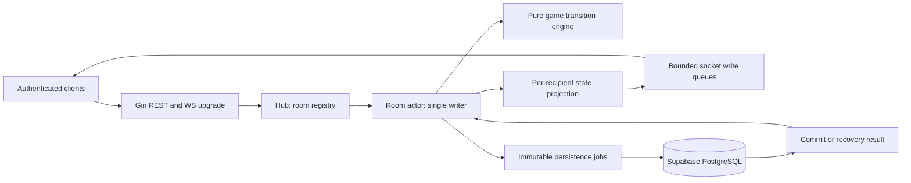

# Authoritative Ticket to Ride: Europe backend plan

Status: Phase 1 implemented and verified; Phases 2–5 remain planned.
Prepared: 2026-11-10. Workspace: `G:\TicketToRide`.
Implementation update: 2026-11-11. See section 12 for actual scope and verification.

## 1. Scope, standards, and resolved decisions

Build a server-authoritative, real-time board-game backend for 2–5 authenticated players, including Supabase Anonymous Auth guests. The server owns shuffles, hands, destination ownership, turn legality, route ownership, scores, and recovery. Clients submit intentions and render recipient-specific views.

The initial workspace was empty: no source files, Go module, Git repository, `AGENTS.md`, or requested local skills/rules were present. This planning deliverable adds:

| Standard | Project-local skill | Rule adapter |
| --- | --- | --- |
| `impeccable` | `.agents/skills/impeccable/SKILL.md` | `.cursor/rules/impeccable.mdc` |
| `golang-concurrency-pro` | `.agents/skills/golang-concurrency-pro/SKILL.md` | `.cursor/rules/golang-concurrency-pro.mdc` |
| `supabase-postgres-architect` | `.agents/skills/supabase-postgres-architect/SKILL.md` | `.cursor/rules/supabase-postgres-architect.mdc` |

`AGENTS.md` activates these standards for repository work. They are authored locally for this backend, rather than downloaded third-party skill implementations.

### 1.1 Selected stack

- Go 1.23+ language requirement; use a currently supported, patched Go toolchain for deployment. The installed toolchain during planning is `go1.26.4 windows/amd64`; verify/update its patch level in Phase 1. Do not pin production to unsupported 1.23 merely because it is the requested minimum. Go supports a major release until two newer majors exist. [Go release policy](https://go.dev/doc/devel/release#policy)
- Gin for REST, Gorilla WebSocket for transport, `pgx/v5/pgxpool` for PostgreSQL, `log/slog` for logging, and a maintained JWT/JWK library selected and version-pinned during Phase 1. No dependency versions or module path are invented in this plan.
- Supabase Auth handles sign-in, anonymous sign-in, and refresh. This backend verifies access tokens; it does not issue Supabase JWTs or accept Supabase API keys as user identities.
- One dedicated actor goroutine per active room; one process initially. Room fencing is included so a restart or future worker cannot write over a newer owner. Multi-node routing, load-balanced WebSocket ownership, matchmaking, bots, spectators, chat, and automated forfeits are later work.
- Latest full JSONB snapshot per room, written asynchronously through a bounded worker pool, with durable publication after commit. No Redis, broker, or Supabase Realtime dependency for gameplay.

### 1.2 Explicit MVP ruleset decisions

These choices make ambiguous requirements implementable and become the versioned `europe-core-v1` contract:

1. **Tunnels/ferries:** preserve all original Europe endpoints, colors, lengths, and parallel groups, but treat every tunnel/ferry edge as an ordinary route in this simplified ruleset. Keep source `kind` and ferry locomotive metadata in the static catalog for later expansion. There are no tunnel extra draws or mandatory ferry locomotives. Removing these edges would change connectivity and make some tickets inappropriate. Clients must label the ruleset as simplified Europe.
2. **Stations:** no stations, borrowed routes, station actions, station inventory, or station points. This also removes station-related tiebreaking.
3. **Initial destinations:** choose the requested `1 long + 3 regular` variant. Each player keeps 2–4, and may reject the long ticket. Unused/rejected initial tickets are removed from this game. Only regular tickets remain available for later draws. The alternative four-standard-ticket setup is deferred.
4. **Train shuffling:** `math/rand/v2` is not the security guarantee implied by “cryptographically secure.” Production uses Fisher–Yates with unbiased `crypto/rand.Int` choices, errors propagated; deterministic tests inject a controlled shuffler. `math/rand/v2` may be used only in seeded tests/simulations. Save resulting deck orders, not a public seed. [Go random package guidance](https://pkg.go.dev/math/rand/v2)
5. **Route scoring:** use the requested `1:1, 2:2, 3:4, 4:7, 6:15, 8:21`, plus `5:10` for a complete scoring table. Reject all other lengths during catalog validation; do not silently assign points.
6. **Longest route:** compute a maximum-weight **trail** in an undirected multigraph. An edge can be used once; cities may repeat. “Simple path” would incorrectly forbid loops. Parallel edges have distinct IDs. Award +10 to every tied maximum, with no station contribution.
7. **Scarcity/liveness:** when fewer train cards exist than required, draw what is legally available. Do not permit an arbitrary pass. `PASS_TURN` is accepted only when no train-card draw, destination draw, or route claim is legal. If every player consecutively has no legal action, finish through an explicit stalemate rule. This is an MVP liveness policy rather than a claim about the printed game.
8. **Offline turns:** preserve the seat and pause at that player's decisions indefinitely in MVP. No hidden timeout move, bot, or forfeiture. Any available player may finish their already-started action if their authenticated replacement socket reconnects.
9. **Game disclosure:** opponents' train-card identities and owned destination identities remain hidden even after game end. End results expose score components, completion counts, and longest-route lengths. A future consent-based reveal/replay is outside MVP.

The official Europe rulebook is the baseline for initial ticket handling, double routes, normal turn rules, and end scoring; the choices above explicitly describe this project's simplifications. [Days of Wonder Europe rulebook](https://cdn.svc.asmodee.net/staging-daysofwonder/uploads/2024/07/7202-T2RE-Rules-EN.pdf)

## 2. Architecture and ownership



### 2.1 Clean Architecture layout

The tree is a target layout, not a set of empty directories to create during planning.

```text
cmd/
  server/main.go                 composition root, signals, graceful shutdown
  migrate/main.go                explicit deployment migration entry point
internal/
  config/                       validated environment configuration
  auth/                         verified Principal, JWKS cache, HTTP middleware
  httpapi/                      Gin routes, request DTOs, limits, error mapping
  application/                  room use cases and orchestration ports
  game/
    model.go                    authoritative domain and phase types
    engine.go                   validation and atomic candidate transitions
    setup.go                    dealing and initial ticket selection
    train_cards.go              deck, discard, market, draw substate
    routes.go                   payment and double-route checks
    destinations.go             offers, returns, BFS connectivity
    scoring.go                  final round, exact trail solver, ranking
    projection.go               per-player allowlist view construction
    catalog/                    immutable validated Europe graph/ticket loader
    testdata/                   small graph/deck regression fixtures
  room/                         actor, mailbox, timers, connections, lifecycle
  ws/                           Hub registry, protocol, read/write pumps
  repository/
    postgres/                   pgx SQL, transactions, fenced snapshot writes
    memory/                     behavior-oriented test adapters
  persistence/                  bounded workers, retries, recovery coordinator
  observability/                redaction, metrics, health/readiness
pkg/
  protocol/                     wire-only versioned public DTOs if shared
assets/
  europe-core-v1/                embedded cities/routes/tickets and manifest
migrations/                     numbered, reviewable SQL up/down migrations
tests/integration/              isolated database and end-to-end WS tests
.agents/skills/                 three project standards
.cursor/rules/                  small editor adapters to those standards
AGENTS.md
BACKEND_PLAN.md
```

Domain code imports the standard library and its own value types. It cannot import Gin, WebSocket, pgx, or the repository. Repository and transport adapters depend inward. Small interfaces live with their consumers: `SnapshotStore`, `RoomStore`, `TokenVerifier`, `Clock`, `Shuffler`, and `Catalog`. Keep `pkg/` limited to a real external consumer; do not create generic utilities simply to fill that directory.

### 2.2 Actor invariants and message flow

- Hub owns a map `roomID -> *ActorHandle` guarded by `sync.RWMutex`. It holds locks only to lookup/register/remove handles. Concurrent first access uses a single creation path; a half-recovered actor is never published.
- The actor exclusively owns `RoomState`, turn progression, deck slices, pending choices, connection generation, per-user ordering, and the state version. REST handlers do not directly update `room_players`.
- Actor messages include `Join`, `LeaveWaitingRoom`, `Attach`, `Detach`, `ClientCommand`, `TimerFired`, `PersistResult`, `ScoreResult`, and `Shutdown`. Actor controls may carry server-verified identity; the client cannot construct those fields.
- Decode/validate transport envelopes outside the actor; validate domain legality inside it. Calculate a candidate on a deep copy, including an immutable snapshot and projected event data. Failed validation has no effect.
- At most one state-changing candidate is awaiting persistence per room. The actor continues handling pongs, connection replacement, cancellations, and worker results. Later mutations wait in a bounded FIFO; a candidate never observes an uncommitted successor. Transport attachment is not allowed to advance authoritative gameplay before recovery/commit resolution.
- After durable commit, install the candidate and emit ordered ACK/events/views. No success or hidden card is delivered before its resulting state can be recovered. If the requester disconnects, complete an already-admitted command; its receipt remains retrievable.
- DB workers, scorers, REST handlers, and socket pumps never receive mutable actor pointers. Encode/copy jobs before enqueue. Worker results include room ID, owner epoch, base/result revisions, and job ID; stale completions are ignored and investigated.
- One read pump and one write pump per WebSocket. Application messages and server pings use the write pump. Gorilla permits one concurrent reader and one concurrent writer, which this design enforces. [Gorilla concurrency contract](https://pkg.go.dev/github.com/gorilla/websocket#hdr-Concurrency)

Initial configurable limits: room inbox 128, pending mutations 64, outgoing messages 32/socket, global persistence workers 8 and jobs 256. Cap active rooms and aggregate memory in deployment configuration. Queue-full paths return `SERVER_BUSY`; a slow socket is disconnected and may resync. Never drop a middle delta and pretend it was delivered. No goroutine-per-send fallback and no unbounded retries.

## 3. Supabase identity, room admission, and transport security

### 3.1 JWT verification

REST uses `Authorization: Bearer <access_token>`. Validate a signed access token before constructing `Principal{UserID, IsAnonymous, ExpiresAt}`. Required checks: approved asymmetric algorithm (project configuration, ES256/RS256 as applicable), signature, pinned issuer `https://<project-ref>.supabase.co/auth/v1` (or explicit custom issuer), audience `authenticated`, valid UUID subject, `exp`, optional `nbf`, bounded clock skew (30 seconds), and `role=authenticated`. Reject `none`, service-role/anon API JWTs, token-selected URLs, missing claims, and algorithm/key confusion.

Fetch keys from the configured `.../auth/v1/.well-known/jwks.json`, never a `jku` supplied by the token. Cache by issuer/kid with finite TTL, single-flight refresh, limited unknown-kid refresh rate, and request timeouts. Refresh once on a new kid; fail closed if a valid trusted key cannot be obtained. Explicitly configured legacy HS256 uses only the server-held legacy secret and a separate allowlist; it is not an asymmetric-verification fallback. Rotation/revocation latency includes cache lifetime and must be documented operationally. [Supabase signing keys](https://supabase.com/docs/guides/auth/signing-keys)

Email users and Anonymous Auth users follow the same authorization path. Guests sign in using Supabase `signInAnonymously()` and retain their session across F5. They have a real `sub` and authenticated database role; the `is_anonymous` claim distinguishes them. Never require a nonempty email for admission. Clearing an anonymous session loses proof of that identity; a display name or room password cannot recover its occupied seat. [Supabase anonymous users](https://supabase.com/docs/guides/auth/auth-anonymous)

Local JWT validation does not instantly detect remote logout/revocation. A socket expires at its verified access-token expiry; the client refreshes through Supabase and reconnects using a new admission token. The server sends `AUTH_EXPIRING` 60 seconds before expiry where possible. No in-band unsigned identity changes.

### 3.2 Passwords and WebSocket admission

- Use bcrypt with per-password salt, initial cost 10, benchmarked against the deployment CPU; reject inputs over bcrypt's 72-byte limit and cap request size. Hash outside the actor; submit only a verified admission capability tied to room/password version. SHA-256 alone is fast to brute-force, so select bcrypt from the requested alternatives. Do not persist plaintext or log password bodies. [Go bcrypt API and limits](https://pkg.go.dev/golang.org/x/crypto/bcrypt)
- A room password controls **new membership**, not permission to impersonate an existing member. Existing members may reconnect using the same verified user ID without re-entering it. Do not expose `password_hash`; return only `has_password`.
- `POST /rooms/{id}/ws-ticket` requires existing membership and a valid JWT. It creates a CSPRNG 256-bit, opaque, single-use credential valid for at most 30 seconds and no longer than the access token. Bind user ID, room ID, expiry, and protocol version; store only its digest in a bounded in-memory admission store.
- Browsers cannot set arbitrary WebSocket Authorization headers. Present the ticket as the second `Sec-WebSocket-Protocol` value (`ttr.v1, ticket.<base64url>`); the server selects only `ttr.v1`, atomically consumes the ticket, and enforces an allowed Origin before upgrading. Configure proxy/header redaction. No JWT or room password in a URL. Native clients can use the same flow.
- Process restart invalidates unconsumed WS tickets; acquire a new one through REST. WSS/HTTPS only outside local development. Disable WebSocket compression initially, reject unexpected binary frames, cap messages at 16 KiB, bound JSON depth/field counts, reject unknown message types and unknown fields in command payloads.
- Initial limits: 20 commands/second/socket with burst 40; password attempts 5/minute per IP plus per-user/per-room buckets; creation/join/ticket issuance also rate-limited. Calibrate via load testing. Identity, membership, host privilege, turn ownership, revision, and phase are checked again when the actor processes a command.

## 4. Database schema and migrations

The following SQL is the proposed migration content, embedded here for review. It has not been applied to Supabase. Phase 2 materializes it into migration files and verifies it against an isolated Supabase-compatible PostgreSQL instance.

### 4.1 `000001_core.up.sql`

Use text checks for statuses rather than a PostgreSQL enum to simplify evolution. `gen_random_uuid()` is available in supported Supabase PostgreSQL. `RESTRICT` on Auth user deletion intentionally preserves active game identity; account cleanup must archive/delete affected rooms through an explicit retention process first.

```sql
BEGIN;

CREATE TABLE public.rooms (
    id uuid PRIMARY KEY DEFAULT gen_random_uuid(),
    room_code varchar(6) NOT NULL UNIQUE
        CHECK (room_code ~ '^[A-HJ-NP-Z2-9]{6}$'),
    name text NOT NULL CHECK (char_length(btrim(name)) BETWEEN 1 AND 80),
    password_hash text,
    password_version bigint NOT NULL DEFAULT 1 CHECK (password_version > 0),
    host_id uuid NOT NULL REFERENCES auth.users(id) ON DELETE RESTRICT,
    max_players smallint NOT NULL CHECK (max_players BETWEEN 2 AND 5),
    status text NOT NULL DEFAULT 'WAITING'
        CHECK (status IN ('WAITING', 'PLAYING', 'FINISHED')),
    state_version bigint NOT NULL DEFAULT 0 CHECK (state_version >= 0),
    owner_instance uuid,
    owner_epoch bigint NOT NULL DEFAULT 0 CHECK (owner_epoch >= 0),
    lease_until timestamptz,
    created_at timestamptz NOT NULL DEFAULT now(),
    updated_at timestamptz NOT NULL DEFAULT now(),
    CHECK ((owner_instance IS NULL) = (lease_until IS NULL))
);

CREATE TABLE public.room_players (
    room_id uuid NOT NULL REFERENCES public.rooms(id) ON DELETE CASCADE,
    user_id uuid NOT NULL REFERENCES auth.users(id) ON DELETE RESTRICT,
    display_name text NOT NULL
        CHECK (char_length(btrim(display_name)) BETWEEN 1 AND 32),
    color text CHECK (color IN ('BLUE', 'RED', 'GREEN', 'YELLOW', 'BLACK')),
    is_ready boolean NOT NULL DEFAULT false,
    is_connected boolean NOT NULL DEFAULT false,
    joined_at timestamptz NOT NULL DEFAULT now(),
    seat smallint NOT NULL CHECK (seat BETWEEN 0 AND 4),
    PRIMARY KEY (room_id, user_id),
    UNIQUE (room_id, color),
    UNIQUE (room_id, seat)
);

ALTER TABLE public.rooms ADD CONSTRAINT rooms_host_is_member
    FOREIGN KEY (id, host_id)
    REFERENCES public.room_players(room_id, user_id)
    DEFERRABLE INITIALLY DEFERRED;

CREATE TABLE public.game_snapshots (
    room_id uuid PRIMARY KEY REFERENCES public.rooms(id) ON DELETE CASCADE,
    turn_number bigint NOT NULL DEFAULT 0 CHECK (turn_number >= 0),
    state_version bigint NOT NULL CHECK (state_version >= 0),
    schema_version integer NOT NULL CHECK (schema_version > 0),
    ruleset_version text NOT NULL,
    catalog_hash text NOT NULL CHECK (catalog_hash ~ '^[0-9a-f]{64}$'),
    state_json jsonb NOT NULL CHECK (jsonb_typeof(state_json) = 'object'),
    updated_at timestamptz NOT NULL DEFAULT now()
);

CREATE TABLE public.room_commands (
    room_id uuid NOT NULL REFERENCES public.rooms(id) ON DELETE CASCADE,
    user_id uuid NOT NULL REFERENCES auth.users(id) ON DELETE RESTRICT,
    request_id uuid NOT NULL,
    command_hash text NOT NULL CHECK (command_hash ~ '^[0-9a-f]{64}$'),
    command_type text NOT NULL,
    state_version bigint NOT NULL CHECK (state_version > 0),
    response_json jsonb NOT NULL CHECK (jsonb_typeof(response_json) = 'object'),
    created_at timestamptz NOT NULL DEFAULT now(),
    PRIMARY KEY (room_id, user_id, request_id)
);

CREATE INDEX rooms_waiting_created_idx
    ON public.rooms (created_at DESC, id) WHERE status = 'WAITING';
CREATE INDEX rooms_host_idx ON public.rooms (host_id);
CREATE INDEX room_players_user_idx ON public.room_players (user_id, room_id);
CREATE INDEX room_players_join_order_idx
    ON public.room_players (room_id, joined_at, user_id);
CREATE INDEX room_commands_retention_idx
    ON public.room_commands (room_id, created_at);

COMMIT;
```

Five player colors are distinct from eight train-card colors. Nullable player color permits choosing a color in the lobby; PostgreSQL uniqueness permits multiple NULLs. The host/member cyclic relationship requires room creation and host insertion in one transaction. Host migration/removal is also atomic. Roster size `<= max_players`, connected/ready start gates, and readiness resets are checked by the actor and repository transaction under a locked room row; a row CHECK cannot enforce an aggregate across players.

Room codes use a non-confusing alphabet and CSPRNG selection, uppercased on lookup. A unique constraint decides collisions; retry generation at most 10 times, then return an operational failure. The code is a locator, never an authentication secret. Room creation uses a preselected room UUID plus caller request ID to resolve uncertain commits and retries.

### 4.2 `000002_backend_access.up.sql`

All user-facing queries go through this Go API. No browser role receives access to these authoritative tables, including member SELECT on snapshots. RLS without policies denies ordinary roles; table owners and BYPASSRLS roles can bypass it. The backend receives a dedicated, non-owner database role with explicit policies. [PostgreSQL RLS behavior](https://www.postgresql.org/docs/current/ddl-rowsecurity.html)

```sql
BEGIN;

-- Provision this role with a separately managed login credential/secret.
-- Execute migrations as the deployment/migration role, never as this runtime role.
DO $$ BEGIN
    IF NOT EXISTS (SELECT 1 FROM pg_roles WHERE rolname = 'ttr_backend') THEN
        CREATE ROLE ttr_backend NOLOGIN NOSUPERUSER NOBYPASSRLS;
    END IF;
END $$;

REVOKE ALL ON public.rooms, public.room_players,
    public.game_snapshots, public.room_commands
    FROM PUBLIC, anon, authenticated, service_role;

ALTER TABLE public.rooms ENABLE ROW LEVEL SECURITY;
ALTER TABLE public.room_players ENABLE ROW LEVEL SECURITY;
ALTER TABLE public.game_snapshots ENABLE ROW LEVEL SECURITY;
ALTER TABLE public.room_commands ENABLE ROW LEVEL SECURITY;

GRANT USAGE ON SCHEMA public TO ttr_backend;
GRANT SELECT, INSERT, UPDATE, DELETE ON public.rooms,
    public.room_players, public.game_snapshots, public.room_commands
    TO ttr_backend;

CREATE POLICY rooms_backend_only ON public.rooms
    FOR ALL TO ttr_backend USING (true) WITH CHECK (true);
CREATE POLICY players_backend_only ON public.room_players
    FOR ALL TO ttr_backend USING (true) WITH CHECK (true);
CREATE POLICY snapshots_backend_only ON public.game_snapshots
    FOR ALL TO ttr_backend USING (true) WITH CHECK (true);
CREATE POLICY commands_backend_only ON public.room_commands
    FOR ALL TO ttr_backend USING (true) WITH CHECK (true);

COMMIT;
```

Runtime credential provisioning is an explicit environment operation: create a LOGIN role, grant membership in `ttr_backend`, and give the secret only to the Go server. Never use a browser publishable key, `service_role` key, migration-owner credential, or inferred end-user JWT context for direct pgx connections. Do not put these tables into a Supabase Realtime publication. Keep the backend login unprivileged on unrelated tables. Verify grants/default grants, role memberships, Data API exposure, and publication membership in integration checks; existing grants from another environment must not silently weaken this model.

### 4.3 Rollback scripts

`000002_backend_access.down.sql` removes its policies and runtime grants but **does not disable RLS or restore browser access**. `000001_core.down.sql` is destructive and only used in disposable environments or a separately authorized rollback with a backup:

```sql
-- 000002_backend_access.down.sql
BEGIN;
DROP POLICY IF EXISTS commands_backend_only ON public.room_commands;
DROP POLICY IF EXISTS snapshots_backend_only ON public.game_snapshots;
DROP POLICY IF EXISTS players_backend_only ON public.room_players;
DROP POLICY IF EXISTS rooms_backend_only ON public.rooms;
REVOKE ALL ON public.rooms, public.room_players,
    public.game_snapshots, public.room_commands FROM ttr_backend;
COMMIT;

-- 000001_core.down.sql
BEGIN;
ALTER TABLE public.rooms DROP CONSTRAINT rooms_host_is_member;
DROP TABLE public.room_commands;
DROP TABLE public.game_snapshots;
DROP TABLE public.room_players;
DROP TABLE public.rooms;
COMMIT;
```

Do not automatically migrate down on startup, drop the provisioned login/group role, or apply schema changes to a live project as part of plan validation.

### 4.4 Fencing, commit transaction, and stale-write prevention

Each process has a random instance UUID. A room owner obtains or renews a 30-second lease; renew every 10 seconds. Database time is authoritative. Takeover locks the room row and increments `owner_epoch` only when its previous lease has expired; lazy-load the persisted snapshot while holding the new ownership. A live second owner is rejected/routed elsewhere, rather than creating a second actor.

Proposed owner-acquisition statement (parameters: room ID, instance UUID):

```sql
UPDATE public.rooms
SET owner_instance = $2, owner_epoch = owner_epoch + 1,
    lease_until = clock_timestamp() + interval '30 seconds'
WHERE id = $1
  AND (owner_instance IS NULL OR lease_until <= clock_timestamp())
RETURNING owner_epoch, state_version;
```

Renew uses `WHERE id=$1 AND owner_instance=$2 AND owner_epoch=$3 AND lease_until > clock_timestamp()`. An expired owner must reacquire a new epoch and recover; it cannot silently renew stale authority. A zero-row result stops command admission and closes owned sockets until recovery.

For every accepted mutation, use a short transaction:

1. `SELECT ... FROM rooms WHERE id=$1 FOR UPDATE`; verify instance, epoch, nonexpired lease, and expected base revision against the immutable job. Row locking serializes ownership transfer with commit.
2. Check `(room_id,user_id,request_id)` receipt **before** revision validation on a retry. Same canonical hash returns its stored ACK; a changed payload yields `REQUEST_ID_REUSED`. Internal presence/timer operations use server job IDs and conditional revision checks.
3. Apply room metadata and roster deltas; a real state change increases room state version exactly once. Snapshot the complete room aggregate, with game nil during WAITING. Insert/update the latest JSONB snapshot only if its version is lower. A validated no-op writes only a receipt at the current version. Turn number alone is insufficient because two draws and ticket offers mutate within one turn.
4. Insert the caller receipt (ACK metadata only, no token/password/hand payload) in the same transaction. Commit; worker sends `PersistResult` to the actor.

The snapshot upsert additionally guards ordering:

```sql
INSERT INTO public.game_snapshots
    (room_id, turn_number, state_version, schema_version,
     ruleset_version, catalog_hash, state_json)
VALUES ($1, $2, $3, $4, $5, $6, $7)
ON CONFLICT (room_id) DO UPDATE SET
    turn_number = EXCLUDED.turn_number,
    state_version = EXCLUDED.state_version,
    schema_version = EXCLUDED.schema_version,
    ruleset_version = EXCLUDED.ruleset_version,
    catalog_hash = EXCLUDED.catalog_hash,
    state_json = EXCLUDED.state_json,
    updated_at = clock_timestamp()
WHERE public.game_snapshots.state_version < EXCLUDED.state_version;
```

A stale/no-row update is an error unless a matching durable receipt proves an already completed command. All aggregate writes require the same fencing transaction; never use the upsert alone as ownership protection. Set lock/statement timeouts and transaction deadlines. Do not hold a transaction open for socket writes or game calculations.

Use direct PostgreSQL or Supabase session pooling for the long-lived Go service. Transaction pooling requires explicit pgx prepared-statement compatibility settings and integration verification; do not assume session features survive it. Bound `MaxConns` per deployment and preserve capacity for Auth/admin operations. Handle `QueryRow.Scan`, `Rows.Err`, explicit rollback, and ambiguous `Commit` outcomes. [Supabase connection modes](https://supabase.com/docs/guides/database/connecting-to-postgres), [pgx pool API](https://pkg.go.dev/github.com/jackc/pgx/v5/pgxpool)

## 5. Domain state, snapshots, and client views

The definitions below specify model shapes, not implementation source to compile in this turn. Named string enums are closed sets validated at load/decode boundaries:

| Type | Values |
| --- | --- |
| `RoomStatus` | `WAITING`, `PLAYING`, `FINISHED` |
| `Phase` | `INITIAL_TICKETS`, `TURN_START`, `DRAW_SECOND_CARD`, `CHOOSE_TICKETS`, `SCORING`, `FINISHED` |
| `TrainColor` | `PINK`, `WHITE`, `BLUE`, `YELLOW`, `ORANGE`, `BLACK`, `RED`, `GREEN`, `LOCOMOTIVE` |
| `PlayerColor` | `BLUE`, `RED`, `GREEN`, `YELLOW`, `BLACK` |
| `RouteColor` | same eight ordinary train colors plus `GRAY`; never `LOCOMOTIVE` |
| `RouteKind` | `NORMAL`, `TUNNEL`, `FERRY` (source metadata; ordinary payment in `europe-core-v1`) |
| `OfferKind` | `INITIAL`, `MIDGAME` |

### 5.1 Static catalog and authoritative in-memory aggregate

```go
package game

import "time"

type UserID string
type RoomID string
type CityID string
type RouteID string
type TicketID string
type RoomStatus string
type Phase string
type TrainColor string
type PlayerColor string
type RouteColor string
type RouteKind string
type OfferKind string

// Catalog is read-only after validation; route IDs identify multigraph edges.
type City struct {
    ID   CityID `json:"id"`
    Name string `json:"name"`
}
type Route struct {
    ID                RouteID    `json:"id"`
    A                 CityID     `json:"a"`
    B                 CityID     `json:"b"`
    Length            int        `json:"length"`
    Color             RouteColor `json:"color"`
    ParallelGroup     string     `json:"parallel_group,omitempty"`
    SourceKind        RouteKind  `json:"source_kind"`
    SourceLocomotives int        `json:"source_locomotives"`
}
type Ticket struct {
    ID     TicketID `json:"id"`
    A      CityID   `json:"a"`
    B      CityID   `json:"b"`
    Points int      `json:"points"`
    Long   bool     `json:"long"`
}
type Catalog struct {
    RulesetVersion string
    SHA256         string
    Cities         map[CityID]City
    Routes         map[RouteID]Route
    Tickets        map[TicketID]Ticket
    Adjacency      map[CityID][]RouteID
}

type RoomMeta struct {
    ID              RoomID     `json:"id"`
    Code            string     `json:"code"`
    Name            string     `json:"name"`
    HostID          UserID     `json:"host_id"`
    MaxPlayers      int        `json:"max_players"`
    Status          RoomStatus `json:"status"`
    HasPassword     bool       `json:"has_password"`
    PasswordVersion int64      `json:"password_version"`
    CreatedAt       time.Time  `json:"created_at"`
}
type PlayerState struct {
    UserID          UserID             `json:"user_id"`
    DisplayName     string             `json:"display_name"`
    Color           PlayerColor        `json:"color"` // empty until selected
    Seat            int                `json:"seat"`
    JoinedAt        time.Time          `json:"joined_at"`
    IsReady         bool               `json:"is_ready"`
    IsConnected     bool               `json:"is_connected"`
    Hand            map[TrainColor]int `json:"hand"`
    DestinationIDs  []TicketID         `json:"destination_ids"`
    TrainsRemaining int                `json:"trains_remaining"`
    RoutePoints     int                `json:"route_points"`
}
type TrainDeckState struct {
    Draw    []TrainColor  `json:"draw"`    // last element is next draw
    Discard []TrainColor  `json:"discard"`
    FaceUp  []*TrainColor `json:"face_up"` // exactly five indexed slots, nullable
    // Nonzero when repeated replacement hit the documented safety limit.
    MarketResetPending bool `json:"market_reset_pending"`
}
type DestinationDeckState struct {
    RegularDraw []TicketID `json:"regular_draw"` // last element is next draw
    Removed     []TicketID `json:"removed"`      // includes unused long/initial rejects
}
type TicketOffer struct {
    OfferID     string     `json:"offer_id"`
    PlayerID    UserID     `json:"player_id"`
    Kind        OfferKind  `json:"kind"`
    TicketIDs   []TicketID `json:"ticket_ids"`
    MinimumKeep int        `json:"minimum_keep"`
}
type TurnState struct {
    Number            int64 `json:"number"` // first actionable turn is 1
    ActiveSeatIndex   int   `json:"active_seat_index"`
    TrainCardsDrawn   int   `json:"train_cards_drawn"`
}
type FinalRoundState struct {
    Triggered         bool   `json:"triggered"`
    TriggeredBy       UserID `json:"triggered_by,omitempty"`
    TriggerTurnNumber int64  `json:"trigger_turn_number,omitempty"`
    TurnsRemaining    int    `json:"turns_remaining"`
}
type PlayerScore struct {
    UserID               UserID `json:"user_id"`
    RoutePoints          int    `json:"route_points"`
    DestinationGains      int    `json:"destination_gains"`
    DestinationPenalties  int    `json:"destination_penalties"` // nonnegative magnitude
    CompletedTicketCount int    `json:"completed_ticket_count"`
    LongestTrailLength   int    `json:"longest_trail_length"`
    LongestTrailBonus    int    `json:"longest_trail_bonus"`
    Total                int    `json:"total"`
    Rank                 int    `json:"rank"`
}
type FinalResult struct {
    Reason    string        `json:"reason"` // FINAL_ROUND or STALEMATE
    Scores    []PlayerScore `json:"scores"`
    WinnerIDs []UserID      `json:"winner_ids"`
}
type GameState struct {
    Phase             Phase                `json:"phase"`
    SeatOrder         []UserID             `json:"seat_order"`
    Turn              TurnState            `json:"turn"`
    Trains            TrainDeckState       `json:"trains"`
    Destinations      DestinationDeckState `json:"destinations"`
    RouteOwners       map[RouteID]UserID    `json:"route_owners"`
    PendingOffers     map[UserID]TicketOffer `json:"pending_offers"`
    FinalRound        FinalRoundState      `json:"final_round"`
    ConsecutivePasses int                  `json:"consecutive_passes"`
    Result            *FinalResult         `json:"result,omitempty"`
}
type RoomState struct {
    SchemaVersion  int                     `json:"schema_version"`
    RulesetVersion string                  `json:"ruleset_version"`
    CatalogHash    string                  `json:"catalog_hash"`
    StateVersion   int64                   `json:"state_version"`
    Room           RoomMeta                `json:"room"`
    Players        map[UserID]*PlayerState  `json:"players"`
    Game           *GameState              `json:"game,omitempty"`
}
```

The snapshot is the whole `RoomState`, including lobby information and a nil game before start. Password hashes live in the repository's private room record, never this state/view. Runtime actor fields are separate: channels, timers, socket references, connection generations, ownership lease, pending persistence job, idempotency cache, and cancellation handles are not JSON state.

When a snapshot reports `SCORING`, restart reruns deterministic final scoring. When it reports `DRAW_SECOND_CARD` or `CHOOSE_TICKETS`, restart restores that pending action instead of granting a fresh turn. Card identities in a hand are represented as color counts; identical train cards need no per-card IDs. All maps/slices/pointers are deep-copied before cross-goroutine handoff.

### 5.2 Recipient-specific sanitized state

The following types share domain value types conceptually; implementation places wire DTOs in `pkg/protocol` only if sharing is needed. Construct them with an explicit allowlist, not by serializing and deleting fields.

```go
type PublicRoomView struct {
    ID          RoomID     `json:"id"`
    Code        string     `json:"code"`
    Name        string     `json:"name"`
    HostID      UserID     `json:"host_id"`
    MaxPlayers  int        `json:"max_players"`
    Status      RoomStatus `json:"status"`
    HasPassword bool       `json:"has_password"`
}
type PublicPlayerView struct {
    UserID          UserID      `json:"user_id"`
    DisplayName     string      `json:"display_name"`
    Color           PlayerColor `json:"color"`
    Seat            int         `json:"seat"`
    IsReady         bool        `json:"is_ready"`
    IsConnected     bool        `json:"is_connected"`
    HandCount       int         `json:"hand_count"`
    TicketCount     int         `json:"ticket_count"`
    TrainsRemaining int         `json:"trains_remaining"`
    RoutePoints     int         `json:"route_points"`
}
type PrivateOfferView struct {
    OfferID     string    `json:"offer_id"`
    Kind        OfferKind `json:"kind"`
    Tickets     []Ticket  `json:"tickets"`
    MinimumKeep int       `json:"minimum_keep"`
}
type SelfView struct {
    UserID         UserID             `json:"user_id"`
    Hand           map[TrainColor]int `json:"hand"`
    Tickets        []Ticket           `json:"tickets"`
    Offer          *PrivateOfferView  `json:"offer,omitempty"`
    AllowedActions []string           `json:"allowed_actions"` // hints only
}
type PublicGameView struct {
    Phase               Phase             `json:"phase"`
    TurnNumber          int64             `json:"turn_number"`
    ActivePlayerID      UserID            `json:"active_player_id,omitempty"`
    TrainCardsDrawn     int               `json:"train_cards_drawn"`
    FaceUp              []*TrainColor     `json:"face_up"`
    TrainDrawCount      int               `json:"train_draw_count"`
    TrainDiscardCount   int               `json:"train_discard_count"`
    TicketDrawCount     int               `json:"ticket_draw_count"`
    RouteOwners         map[RouteID]UserID `json:"route_owners"`
    AwaitingTicketUsers []UserID           `json:"awaiting_ticket_users"`
    FinalRound          FinalRoundState   `json:"final_round"`
    MarketResetPending bool              `json:"market_reset_pending"`
    Result              *FinalResult      `json:"result,omitempty"`
}
type ClientStateView struct {
    SchemaVersion  int                `json:"schema_version"`
    RulesetVersion string             `json:"ruleset_version"`
    CatalogHash    string             `json:"catalog_hash"`
    StateVersion   int64              `json:"state_version"`
    Room           PublicRoomView     `json:"room"`
    Players        []PublicPlayerView `json:"players"` // stable seat order
    Game           *PublicGameView    `json:"game,omitempty"`
    Self           SelfView           `json:"self"`
}
```

Only the authenticated recipient's hand, kept tickets, and pending offer appear in `self`. Public data may include opponents' counts and known claimed routes, never private color counts or ticket endpoints/IDs. There is no full destination deck order, train deck order, removed ticket list, internal RNG, credential, or worker metadata. The catalog endpoint exposes cities and public routes; it does not need to publish a destination deck. Even during `FINISHED`, result structures contain aggregates only.

## 6. Lobby and resilience lifecycle

### 6.1 REST contract

All room APIs require a verified Email/Anonymous Auth access token. IDs are UUIDs. JSON errors use `{ "error": { "code": "...", "message": "...", "retryable": false }, "request_id": "..." }`. Mutations require a UUID `Idempotency-Key`; create also uses the client's proposed `room_id` UUID. List operations are cursor-paginated with a maximum of 50 entries.

| Method/path | Input | Behavior/output |
| --- | --- | --- |
| `GET /health/live` | none | process liveness; no sensitive diagnostics |
| `GET /health/ready` | none | initialized catalog/auth and usable database; no admission while draining |
| `GET /v1/catalog/europe-core-v1` | none | cities, ordinary-MVP routes, source kind, ruleset/hash; ETag |
| `GET /v1/rooms?cursor=...` | filters `status=WAITING` | safe room summaries, player counts, `has_password`; no roster private state |
| `GET /v1/rooms/by-code/{code}` | normalized code | same safe summary; no password proof or implicit join |
| `POST /v1/rooms` | `room_id,name,max_players,password?,display_name` | create WAITING room + host membership + initial snapshot atomically; 201 and sanitized lobby view |
| `POST /v1/rooms/{id}/join` | `password?,display_name` | verify password off actor, then recheck version/status/capacity inside actor; allocate seat; 200/201 member lobby view |
| `POST /v1/rooms/{id}/leave` | `{}` | remove own WAITING seat; migrate host atomically; reject during PLAYING; last member deletes waiting aggregate |
| `POST /v1/rooms/{id}/ws-ticket` | `{}` | member-only single-use admission token and expiry; `Cache-Control: no-store` |
| `GET /v1/rooms/{id}/state` | none | actor-generated `ClientStateView` for member; useful resync fallback |
| `GET /v1/rooms/{id}/commands/{request_id}` | none | only caller's durable receipt, or 404 if never committed |
| `GET /v1/ws/rooms/{id}` | WS upgrade/subprotocol | consume bound WS ticket; attach; recipient-specific `FULL_STATE_SYNC` |

Do not implement a standalone password-validation endpoint that bypasses join or creates a long-lived reusable grant. New joins are WAITING-only; same-user existing-member reconnect is allowed during PLAYING/FINISHED. No REST endpoint can mutate a running game's state outside the actor. Before room creation an HTTP idempotency cache is insufficient: retry by proposed room UUID and durable creator receipt, checking the original canonical payload.

HTTP mapping: malformed 400; missing/invalid token 401; wrong password or unauthorized action 403; missing room/receipt 404; conflict/full/phase 409; rate limit 429; unavailable/unknown commit resolution 503. Do not return SQL error text. Domain-specific codes remain stable across REST and WS.

### 6.2 Waiting room, host, and readiness

Creation makes the creator host but `is_connected=false` until WS attach. Joining allocates the lowest free seat; the stable initial turn order is join time then UUID. Display names are normalized, bounded, and rendered as text by clients. Color selection is exclusive. Color or roster changes reset all ready flags; changing one's display name resets that player's ready flag. Password/max-player/name editing and explicit host transfer are deferred.

`SET_READY(true)` requires a selected color and an active connection. `START_GAME` is host-only and valid only if 2–5 players are present, count is within capacity, every player has a distinct color, is connected, and is ready (including host). Start takes a fixed roster, deals once, sets DB status PLAYING and phase INITIAL_TICKETS atomically, and creates each private offer. No replacement players after this point.

On current-generation host disconnect in WAITING, set disconnected and not-ready, choose the connected remaining member with earliest `(joined_at,user_id)`, set `host_id`, and emit `PLAYER_CONNECTION_CHANGED` then `HOST_CHANGED`. If no other connected member exists, retain the current host temporarily; on the next non-host attach, promote the earliest connected member while the host remains offline. Reconnecting former hosts do not automatically reclaim hostship. During PLAYING there is no host migration affecting game authority; turn ownership remains the rules engine's decision.

### 6.3 Heartbeats, refresh, and socket replacement

- Writer sends WebSocket Ping every 20 seconds; reader Pong handling extends the 60-second read deadline. Application writes have a 10-second deadline. First read timeout/close triggers one detach for that connection generation.
- F5 commonly produces overlapping sockets: authenticate replacement, attach a new generation, retire/close the old socket, then ignore late detach/pong callbacks from the old generation. At most one active socket per user/room in MVP.
- Detach during PLAYING preserves membership, hand, tickets, turn, and pending choices. Commit `is_connected=false` and broadcast connection status to remaining peers. Heartbeat pongs themselves do not create snapshots; only a connection-status transition does.
- Successful attach commits connected status and immediately sends `FULL_STATE_SYNC` as the first application event to that socket. Then it may receive later deltas. “Immediately” means after verification, ownership recovery if needed, and durable state installation; never send uncommitted secrets.
- If a prior command's commit is unresolved, complete resolution first; no stale full sync followed by a rollback. When no DB progress is possible, fail admission or send a transport-only `ROOM_UNAVAILABLE`, then close; clients retry with jitter.
- Preserve guest Supabase refresh-session storage across reload. A new anonymous `sub` cannot claim an old anonymous seat.

### 6.4 Recovery, failure, and shutdown guarantees

Every accepted mutation, including first train draw and ticket offer, produces a complete immutable snapshot. Workers do I/O asynchronously; the actor uses a commit barrier before publishing. Thus acknowledged actions survive process crash assuming PostgreSQL's committed durability. Network delivery is at-least-once from the client's perspective; durable idempotency supplies exactly-once **effects**, not exactly-once delivery.

| Failure | Required behavior |
| --- | --- |
| Candidate validation fails | reject, no version/deck mutation |
| Job queue full before admission | `SERVER_BUSY`, no candidate installed |
| SQL rollback definitely failed/aborted | discard candidate, return retryable failure |
| Connection lost during COMMIT | outcome unknown; freeze further mutations, lock the room row in a fresh resolution transaction so the old transaction finishes before querying receipt/revision |
| Receipt proves commit | install matching persisted aggregate, replay ACK, send fresh full views as needed |
| No receipt and base revision still current after resolution | safe to retry same immutable candidate/request under current fence |
| Resolution unavailable | keep room unavailable; never regenerate a different random candidate under same request ID |
| Owner lease lost | cease admission/publication, discard stale worker results, close sockets and reacquire/recover under new epoch |
| Client loses ACK | resend identical request ID/payload; receive saved receipt then optionally full sync |
| Slow receiver | disconnect it; preserve seat; reconnect with full sync |

Recover lazily or at startup: acquire room lease, load room/roster/latest snapshot, verify matching revisions, schema/ruleset/catalog hashes, and all domain invariants; fail closed on unsupported/corrupt state. Reconcile duplicate roster columns against the snapshot, not arbitrary last-writer merging. Set all previously connected flags to false through a new recovery snapshot before accepting sockets, reset their waiting-room readiness, and apply host rules on first connection. The next command sees the recovered version.

Latest snapshot is sufficient for recovery, not historical replay. PostgreSQL backups/PITR and room retention are deployment tasks. Purge finished rooms/receipts together after a configurable retention period (initial target 30 days); do not purge active anonymous Auth users behind reserved seats. Bound receipt caches in memory while retaining durable command IDs through room lifetime.

Shutdown order: fail readiness/admission, stop new room commands, finish/resolve in-flight commits within a 15-second drain budget, persist final status transitions where possible, close socket writers, cancel timers/workers, wait for tracked goroutines, release leases, close pgx pool last. Unfinished acknowledged work is already durable. A node without DB connectivity cannot safely continue gameplay.

## 7. WebSocket protocol v1

One UTF-8 JSON object per text frame. `room_id` must match the admission-bound room. All enum/type values are case-sensitive. All IDs are strings; revision/turn/sequence numbers are JSON integers capped below `2^53` for browser safety. Timestamps use RFC 3339 UTC. Optional fields are omitted, never assigned undocumented meanings. Wire-schema changes require a new negotiated protocol version.

### 7.1 Envelopes and ordering

Client command example:

```json
{
  "v": 1,
  "type": "DRAW_TRAIN_CARD",
  "request_id": "2ae4de17-d485-4c05-9f0c-cd6aa4af60a0",
  "room_id": "64897aae-5dc8-45e7-a1c8-3ffdb8b08fbd",
  "expected_version": 18,
  "payload": { "source": "FACE_UP", "slot": 2, "expected_color": "BLUE" }
}
```

Server event example:

```json
{
  "v": 1,
  "type": "COMMAND_ACK",
  "room_id": "64897aae-5dc8-45e7-a1c8-3ffdb8b08fbd",
  "request_id": "2ae4de17-d485-4c05-9f0c-cd6aa4af60a0",
  "delivery_seq": 7,
  "state_version": 19,
  "server_time": "2026-11-10T06:00:00Z",
  "payload": { "command_type": "DRAW_TRAIN_CARD", "committed_version": 19, "duplicate": false }
}
```

`delivery_seq` increases per socket, including private and transport events, and resets to 1 on a replacement connection. `state_version` increases once per committed aggregate change; multiple events may share it. It is not a per-client event count. All client commands have a UUID `request_id`; mutations also require `expected_version`. `REQUEST_SYNC` omits expected version and can include last seen version/sequence for diagnostics. Never accept a client-supplied `user_id`, score, shuffled deck, computed route length, or claimed completed-ticket assertion.

Idempotency key scope is `(room_id, authenticated_user_id, request_id)`, shared between REST and WS. Hash canonical command type and normalized semantic payload, excluding transport fields and `expected_version`; this allows the identical intent to be retried after a stale-version rejection. Successful mutations are receipted durably. A rejected command has no effect and may be retried with a corrected expected version; a changed semantic payload uses a new request ID. Concurrent duplicate requests share one in-flight result. Check successful duplicates before checking old expected versions. A successful duplicate never repeats a draw, claim, offer, or turn advance.

For a committed mutation: ACK to caller, relevant safe narrative events to their specified audiences, then `STATE_UPDATED` with a newly projected full view to each connected member. State updates are the authoritative source of rendering; narrative events are animation hints. This MVP intentionally uses full sanitized views rather than a partially specified patch format. Across all recipients, no future committed view can overtake an earlier one in their write queue.

### 7.2 Client → server commands

All mutation commands require current-generation member connection and the expected committed revision. The active player/phase checks below are in addition to membership checks.

| Type | Exact payload fields | Preconditions / effect |
| --- | --- | --- |
| `SET_COLOR` | `color: PlayerColor` | WAITING; unused color; selecting same color is a no-op; real change resets readiness |
| `SET_DISPLAY_NAME` | `display_name: string` | WAITING; 1–32 normalized characters; real change resets own readiness |
| `SET_READY` | `is_ready: boolean` | WAITING; true requires chosen color; no-op if unchanged |
| `START_GAME` | `{}` | current host; all start gates; deal once and enter INITIAL_TICKETS |
| `SELECT_DESTINATION_TICKETS` | `offer_id: string, keep_ticket_ids: string[]` | own current offer; unique IDs from offer; keep at least minimum and no more than offer size; resolves setup or midgame action |
| `DRAW_TRAIN_CARD` | blind: `source:"BLIND"`; market: `source:"FACE_UP", slot:0..4, expected_color:TrainColor` | active player, TURN_START or DRAW_SECOND_CARD; validate legal source/locomotive rules; persist after each draw |
| `CLAIM_ROUTE` | `route_id: string, payment:{color:TrainColor, colored:int, locomotives:int}` | active player at TURN_START; ordinary `color` excludes LOCOMOTIVE; length-matched explicit spend; claim once and end turn |
| `DRAW_DESTINATION_TICKETS` | `{}` | active player at TURN_START; nonempty regular deck; draw up to 3 and enter CHOOSE_TICKETS |
| `PASS_TURN` | `{}` | TURN_START; only when exhaustive legal-action check proves no move; advances liveness/final-round counters |
| `REQUEST_SYNC` | optional `last_state_version:int, last_delivery_seq:int` | any phase; no mutation; return current private FULL_STATE_SYNC |

No client `END_TURN` exists: the engine ends it when the chosen action completes. A player who draws the first ordinary train card cannot switch to claiming a route or drawing tickets. No command can cancel an issued ticket offer to inspect another one. A host has no privilege to read another hand or take their turn.

No-op mutations return an ACK with the current committed version and a durable receipt, without advancing the room version; repository logic must distinguish this from a real mutation. They cannot bypass expected-version or authorization checks. Startup creation begins at revision 1, so no-op receipts have a positive revision.

### 7.3 Server → client events

`user_id` in an event denotes an actor/player, never authorization supplied by a client. `PublicPlayerView`, `ClientStateView`, `PrivateOfferView`, and result payloads are defined in section 5.

| Type | Audience | Payload |
| --- | --- | --- |
| `FULL_STATE_SYNC` | attached/requesting user only | `{state: ClientStateView, reason:"ATTACH"\|"REQUESTED"\|"RECOVERED"\|"GAP"}` |
| `STATE_UPDATED` | each member, separately projected | `{state: ClientStateView}` |
| `COMMAND_ACK` | requester only | `{command_type, committed_version, duplicate:boolean}`; duplicate can refer to an older revision |
| `COMMAND_REJECTED` | requester only | `{code, message, retryable, current_version, resync_required}`; same request ID; no private opponents' state |
| `PLAYER_JOINED` | existing connected members | `{player:PublicPlayerView}` |
| `PLAYER_LEFT` | connected members | `{user_id, reason:"LEFT_WAITING"}` |
| `LOBBY_UPDATED` | connected members | `{changed_user_id, changed_fields:string[], ready_reset_user_ids:string[]}` |
| `PLAYER_CONNECTION_CHANGED` | connected members | `{user_id, is_connected:boolean}` |
| `HOST_CHANGED` | connected members | `{previous_host_id, host_id, reason:"DISCONNECTED"\|"LEFT"\|"RECOVERY"}` |
| `GAME_STARTED` | connected members | `{ruleset_version, catalog_hash, seat_order:user_id[], phase:"INITIAL_TICKETS"}` |
| `DESTINATION_TICKETS_OFFERED` | offer owner only | `{offer:PrivateOfferView}` |
| `DESTINATION_TICKETS_KEPT` | connected members | `{user_id, kept_count:int, kind:"INITIAL"\|"MIDGAME"}`; no ticket IDs |
| `TRAIN_CARDS_DRAWN` | drawing user only | `{cards:TrainColor[], turn_complete:boolean}`; one card per current command |
| `TRAIN_CARDS_DRAWN_PUBLIC` | connected members | `{user_id, count:int, turn_complete:boolean}` |
| `FACE_UP_CARDS_CHANGED` | connected members | `{face_up:[TrainColor|null x5], reset:boolean, reset_pending:boolean}`; no deck order |
| `ROUTE_CLAIMED` | connected members | `{user_id, route_id, trains_spent:int, points_awarded:int}` |
| `TURN_STARTED` | connected members | `{user_id, turn_number:int}` |
| `TURN_PASSED` | connected members | `{user_id, reason:"NO_LEGAL_ACTION"}` |
| `FINAL_ROUND_STARTED` | connected members | `{triggered_by, trigger_turn_number, turns_remaining:int}` |
| `SCORING_STARTED` | connected members | `{reason:"FINAL_ROUND"\|"STALEMATE"}` |
| `GAME_ENDED` | connected members | `{result:FinalResult}`; destinations/hands stay private |
| `AUTH_EXPIRING` | affected socket | `{expires_at:RFC3339, reconnect_required:true}` |
| `ROOM_UNAVAILABLE` | affected sockets | `{code:"PERSISTENCE_UNAVAILABLE"\|"OWNER_LOST"\|"RECOVERY_FAILED", retry_after_ms:int}` |
| `SERVER_SHUTDOWN` | all sockets | `{retry_after_ms:int}` followed by close |

An error envelope uses the same request ID whenever decodable. For invalid JSON with no usable request ID, emit a generic protocol error once and close with 1007; policy/auth violations use 1008, oversized frames 1009, temporary overload 1013, server shutdown 1001, and replaced connection 4001 (documented application code). Repeated invalid commands may close with 1008. Ping/Pong are WebSocket control frames, not game events.

Stable rejection codes: `INVALID_MESSAGE`, `UNSUPPORTED_VERSION`, `UNAUTHENTICATED`, `TOKEN_EXPIRED`, `FORBIDDEN`, `NOT_MEMBER`, `ROOM_NOT_FOUND`, `ROOM_FULL`, `ROOM_LOCKED`, `INVALID_PASSWORD`, `COLOR_TAKEN`, `NOT_READY`, `NOT_HOST`, `NOT_YOUR_TURN`, `WRONG_PHASE`, `STALE_STATE`, `REQUEST_ID_REUSED`, `INVALID_OFFER`, `INVALID_TICKET_SELECTION`, `EMPTY_DECK`, `INVALID_MARKET_SLOT`, `MARKET_CHANGED`, `FACE_UP_LOCOMOTIVE_NOT_ALLOWED`, `ROUTE_UNAVAILABLE`, `DOUBLE_ROUTE_BLOCKED`, `INSUFFICIENT_CARDS`, `INVALID_PAYMENT`, `INSUFFICIENT_TRAINS`, `PASS_NOT_ALLOWED`, `RATE_LIMITED`, `SERVER_BUSY`, `PERSISTENCE_UNAVAILABLE`, and `OWNER_LOST`.

For `STALE_STATE`, include current revision and set `resync_required=true`; send a fresh FULL_STATE_SYNC. The client only retries unchanged intent if still desired and legal. Unknown/gapped delivery sequence also causes REQUEST_SYNC. Reconnect always starts with a full view; no event replay assumption or reliance on a private event from another socket.

## 8. Europe core rules engine

### 8.1 Catalog loader and deterministic transitions

Embed reviewed JSON assets and a manifest with schema/ruleset version, counts, and SHA-256 content hash. Source the Europe board/tickets from a verified base-game catalog during Phase 1; no complete board asset exists in this workspace yet. Verify the base deck has 46 tickets (6 long, 40 regular). Do not substitute anniversary expansions or invented endpoints. Record provenance and manually cross-check every route/ticket against the selected base edition before accepting the loader.

Loader validation: IDs unique; names nonempty; route/ticket endpoints exist and differ; lengths supported; colors/kinds valid; ferry metadata sensible; parallel members share unordered endpoints and each edge belongs to at most one pair; adjacency contains both ends exactly once; ticket points positive; all ticket endpoints connected in the simplified graph; expected counts/hash match the reviewed manifest. Catalog maps become immutable; traversal and emitted slices use stable ID order. Graph edges are undirected.

Transitions have the conceptual API `Apply(state, authenticatedCommand, injectedInputs) -> candidate, domainEvents, error`. Avoid I/O in this function. Randomness is an injected boundary: generate/store all resulting permutations in the candidate. A replay uses saved outcomes or snapshots, never fresh random sampling. Time/IDs needed for offers/metadata are supplied values; game legality never depends on wall-clock map order.

Required invariants after every accepted transition and on snapshot load:

- Train-card counts across all player hands + draw + discard + nonnil face-up slots total 110; ordinary colors each total 12, locomotives 14.
- Every original destination ID appears exactly once across kept tickets, regular draw deck, pending offers, and removed pile. No ticket can be in two hands or two offers.
- For each player, remaining plastic trains + total lengths of their claimed edges = 45; counts and balances are nonnegative.
- Each route has at most one owner; owner is in the fixed roster. Parallel-route restrictions hold for the starting player count.
- Room snapshot revision matches normalized tables; turn owner/phase/offers are compatible; final-round count is valid.
- Route score equals the sum of the route score table over owned edges. Never trust a cached total received from a client.

### 8.2 Setup

1. Freeze 2–5 seats in `(joined_at,user_id)` order; host does not get an extra move. First player is the first seat as an explicit MVP convention.
2. Build 110 train cards: 12 of each ordinary color, 14 locomotives; securely shuffle. Deal four per player in stable round-robin order; every player starts with 45 trains and zero route points.
3. Shuffle regular and long destinations independently. Allocate one long and three regular to each player. Remove unused long tickets; keep remaining regular tickets as the midgame deck. Create offers with unique offer IDs and minimum keep 2.
4. Fill the five face-up slots, applying locomotive-market replacement. Persist the dealt state before sending private offers.
5. All players may select their own initial offers independently, serialized by the actor. Reject duplicates/unoffered IDs or fewer than two kept. Remove rejected initial tickets from the game. No normal turn can start until every offer is resolved.
6. On the last selection, enter TURN_START with turn number 1 and first seat; emit TURN_STARTED. Setup selections do not consume final-round/normal turns.

### 8.3 Train deck and locomotive market

Take the next card from the end of `Draw`; when empty, securely shuffle `Discard` into `Draw` and clear discard. Never reshuffle cards still in hands, face-up, or an unresolved candidate. If both draw and discard are empty, a blind draw is unavailable; face-up slots can still be drawn. Refill a removed market slot immediately if supply exists; otherwise leave it null.

At setup and after every refill, if all five slots are populated and at least three are locomotives, move all five cards to discard and deal a replacement five. Each replacement conserves cards. Scarcity may make a compliant market impossible (e.g. fewer than three accessible ordinary cards). Detect that case rather than loop forever: mark reset pending, retain a usable partial/current market, and retry only when accessible supply changes. For merely unlucky repeated shuffles, cap synchronous replacements at 32, mark reset pending, and schedule at most one bounded actor continuation per supply change (also at most 32 replacements); never busy-spin or starve the room. If that continuation also exhausts its budget, wait for a supply change. Blind draws remain legal while normalization is pending; face-up draws wait for normalization unless it is mathematically impossible with current supply. This bounded/degraded behavior is a documented MVP edge policy.

At TURN_START:

- A face-up locomotive is legal and immediately completes the action with one card.
- Any ordinary face-up card or a blind card grants one draw and enters DRAW_SECOND_CARD. A blind locomotive is ordinary for draw cost and does not reveal itself to others.
- In DRAW_SECOND_CARD, a face-up locomotive is forbidden; blind or an ordinary face-up card is legal. Market replacement occurs between draws, and the second command references the new slot/color/revision.
- If there is no legal second card anywhere (including the case of only face-up locomotives remaining), end the turn automatically after the first draw. No arbitrary client end-turn action is needed.
- A blind draw never leaks its identity through public narrative events, errors, RNG state, or logs. After two normal draws, reset draw substate and advance the turn.

### 8.4 Claiming routes

Only at TURN_START, validate all of the following before spending anything:

1. Route exists and is unclaimed; player has enough plastic trains.
2. In 2–3-player games, no edge in the parallel pair is already claimed by anyone. In 4–5-player games both may be claimed by different players; one player still cannot own both members. Treat parallel groups explicitly, not every route between similarly spelled city names.
3. Payment integers are nonnegative; `colored + locomotives == route.Length`; the hand has both amounts. Nonzero colored spend must use the route's required color for a colored route, or a single chosen ordinary color for gray. Do not mix ordinary colors.
4. All-locomotive payment is legal; for a colored route the color field remains that route's color, and for gray use any valid ordinary color as an ignored zero-count placeholder. Locomotive counts are always separate. Extra cards or mixed payment are rejected rather than silently chosen by the server.
5. Source ferry/tunnel metadata creates no special payment in this ruleset; UI and loader agree on simplified behavior.

Move the exact payment into discard, decrement trains by route length, record ownership, add route points, then normalize the face-up market if pending and accessible supply changed. End the turn through the common turn-finalization function. Score is server-derived, never a client delta.

### 8.5 Drawing destinations

Only at TURN_START and with a nonempty regular deck: remove up to three tickets into one persisted private offer, minimum keep 1, phase CHOOSE_TICKETS. This reserves the turn, not a completed action yet. Player must submit a unique subset of that exact offer. Kept tickets join their hidden destinations; rejected midgame tickets go to the **bottom** of the regular deck in their original offer order. The stored draw convention means prepending the reversed rejected sequence so the first rejected ticket is the first encountered when that bottom segment is eventually reached. Do not shuffle the ticket deck on returns and do not return initial rejections. Resolve offer, then finish turn. Empty ticket deck rejects the draw with no mutation.

### 8.6 Final-round accounting

Use one common `finishTurn` path for a route, completed train draw, completed ticket selection, or legal pass:

1. If final round is already active, decrement `TurnsRemaining` once for the completed turn. When it reaches zero, enter SCORING without starting another turn.
2. Otherwise, if the acting player now has `TrainsRemaining <= 2`, record player and current turn, set final round active with `TurnsRemaining = playerCount`, and **do not decrement for this triggering turn**.
3. Advance to next seat and increment turn number if scoring did not begin. Each subsequent complete turn decrements once. Never retrigger/reset the counter for another low-train player.

Example, seats A/B/C and B triggers at turn t: C, A, B each get one more complete turn; then score. Pending second draws or ticket offers are part of one turn, not additional final-round turns. Snapshot all these fields. Offline status never decrements or skips them. Consecutive mandatory no-move passes can also lead to SCORING with STALEMATE reason; reset that count whenever a non-pass action completes.

### 8.7 BFS destination verification

Build an adjacency list for each player using only their claimed edges. For every owned destination, BFS from A and test reachability of B (cache components or source searches if useful). Complexity is `O(V+E)` per BFS; no need for shortest distance. Completed ticket adds its points; incomplete ticket subtracts them. Completion status stays hidden until the owner's final self view/result calculation; never broadcast a live “opponent completed ticket” event.

### 8.8 Exact longest continuous trail and final ranking

For each player, assign a compact index to each owned edge. DFS/backtrack from every incident city, tracking **used edges**, adding route lengths, and undoing the edge mark on return. Revisited vertices, closed loops, and distinct parallel edges are legal; reused edges are not. Try all starting vertices because the optimal trail need not start at a leaf. Cache states `(currentCity, usedEdgeSet)` where useful and prune by a safe upper bound from remaining reachable edges. Do not substitute vertex-visited DFS, diameter, shortest-path length, or a greedy chain.

This exact problem is exponential in the worst case. The 45-train budget bounds a player's claimed subgraph but is not a proof of cheap runtime. Run scoring on a bounded worker with an immutable graph, per-job cancellation, and benchmarks on dense legal ownership fixtures. Do not silently replace exact results with an approximation on timeout; remain SCORING and retry/recover deterministically, surfacing an operational fault. The scoring result carries a hash of immutable scoring inputs plus owner epoch/job ID. Presence-only revision changes during SCORING need not invalidate that hash; route/ticket input mismatch or ownership change does.

After computing every maximum, award +10 to every tied longest-trail player. With all lengths zero, all are tied; this is the explicit zero-route MVP policy. Total = route points + destination gains − destination penalties + longest bonus. Rank by total, then number of completed tickets, then whether they hold the longest-route bonus; unresolved equals share rank and win. No station tiebreak/unused-station points apply. Persist final breakdown and FINISHED status atomically; only then publish GAME_ENDED.

## 9. Verification and operations

### 9.1 Behavior-focused verification matrix

| Area | Required evidence |
| --- | --- |
| JWT verification | valid Email and Anonymous Auth tokens; wrong issuer/audience/role; expiry/nbf; invalid signature; missing sub; algorithm confusion; kid rotation and unknown-kid flooding; legacy config isolation |
| Catalog | endpoint/ID/length/color validation; parallel edge identity; provenance/count/hash check; stable loader output; reject incompatible snapshot hash |
| Setup/decks | full 110-card distribution; independent hands; initial ticket minimum 2; unused/rejected ticket partition; deterministic injected shuffle; crypto entropy failure aborts candidate |
| Train actions | face-up locomotive costs whole turn; forbidden on second draw; blind locomotive costs one draw; refill/reshuffle between draws; partial/empty supply; 3+ locomotives; impossible market terminates |
| Routes | every scoring-table length; exact payment and wildcard cases; gray route single color; insufficient trains; no side effects on rejection; 2/3 and 4/5-player double-route cases including same-player restriction |
| Destinations | private offer survives restart; minimum 1 midgame; fewer than three available; returned-bottom order; initial rejects removed; BFS disconnected/connected graphs |
| Turn/endgame | every trigger seat for 2–5 players; trigger turn not counted; exactly N later turns; offer/second draw counted once; later low-train players cannot reset counter; no-action stalemate |
| Longest trail | line, cycle, revisited city, branch, disconnected components, parallel edges, weighted route lengths, tied bonus, zero-route policy; exact comparison with exhaustive oracle on small graphs |
| Actor/concurrency | simultaneous claim/draw/ready/start; one commit wins expected revision; stale jobs/detaches; F5 overlap; slow consumer; full queues; cancelled shutdown; no goroutine/channel leaks |
| Privacy | two-player fixtures with distinct secret cards/tickets; serialize every event and full sync for each recipient, REST views, errors, logs, metrics, and final result; assert only own secrets occur |
| Database | migrate up/down in disposable DB; host membership deferred FK; color/seat/code uniqueness; aggregate transaction rollback; Data API/RLS denial for anon/authenticated; backend grants work |
| Persistence | snapshot round trip for every phase; out-of-order revisions; commit-before-ACK; lost ACK duplicate; request-ID changed payload rejection; uncertain COMMIT; fencing/takeover; corrupt snapshot denial |
| End to end | 2–5 clients create/join/select/ready/start/play; disconnect/reconnect during both pending actions; waiting-host migration; process kill/restart at commit boundary; final scores unchanged |

Use table-driven unit tests for engine rules, fuzzing for protocol decoders and legal command sequences, and generated small graphs for independent longest-trail checking. Inject clock, shuffler, ID generation, repository, and transport boundaries; avoid sleep-dependent tests. Integration tests use isolated credentials/schema and never the user's production project by default.

Run `gofmt`, `go vet ./...`, `go test ./...`, and `go test -race ./...` for implemented packages, then `govulncheck ./...` and focused load/fault tests before release. On Windows the race detector may require CGO and a C compiler; if unavailable locally, run the mandatory race suite in supported Linux CI and disclose that local limit. Phase 1 checks have now run; results appear in section 12. Gameplay/database fault checks await their implementation phases.

### 9.2 Observability and runtime configuration

Structured logs carry request ID, room ID, user ID where appropriate, owner epoch, committed revision, command type, and safe error code. Never log JWTs, passwords/hashes, admission tokens, full snapshots, hands, private ticket payloads, raw WS frames, or query argument dumps. Restrict profiling/debug endpoints to an internal listener; panic handling must redact request bodies.

Metrics: active rooms/sockets, inbox/outbox utilization, rejected commands by bounded code, command-to-commit latency, persistence failures/unknown outcomes, snapshot bytes, lease renewal failures, reconnects, slow-consumer closes, JWKS refreshes, and scoring duration. Avoid room/user IDs as metric labels. Initial service target under a healthy regional DB: p95 command-to-commit-to-enqueue <150 ms at the measured supported load; this is a target to benchmark, not a claimed result.

Environment contract to materialize in `.env.example` during implementation: `HTTP_ADDR`, `SUPABASE_URL`, `SUPABASE_JWT_ISSUER`, `SUPABASE_JWT_AUDIENCE`, `SUPABASE_JWKS_URL`, configured JWT algorithms, optional explicitly enabled legacy secret, `DATABASE_URL`, `ALLOWED_ORIGINS`, `BCRYPT_COST`, pool/worker/queue limits, room limit, heartbeat/deadline settings, and `SHUTDOWN_TIMEOUT`. Validate required values at startup. Local `.env` and secrets must be ignored by Git once repository tooling is initialized. Remote DB connections require TLS with certificate verification.

Migrations run explicitly before compatible server rollout. Readiness requires the expected schema and compatible catalog, rather than silently modifying production schema on every boot. Backup/restore drills must include hidden snapshot access controls. Multi-node expansion additionally requires sticky room routing/owner discovery, cross-node admission credential handling, coordinated drains, lease/partition fault tests, and measured database capacity; an RWMutex only protects one process.

## 10. Five-phase implementation roadmap

### Phase 1 — Foundation, Supabase identity, and Europe static graph loader

Deliver:

- Initialize the Go module using the actual repository/module path (derive it from repository origin when available; otherwise choose a documented local module path), pin compatible dependencies, and add the initial `cmd/server` composition root with Gin health routes and validated configuration.
- Implement Supabase Auth verification middleware, Principal propagation, bounded JWKS cache, Email/Anonymous Auth acceptance, and verification tests with locally generated signing keys. Include explicit token-expiry/rotation handling.
- Add the immutable Europe catalog model, reviewed base-game JSON assets and manifest, `go:embed` loader, graph validation, and public simplified-map endpoint. Preserve source tunnel/ferry metadata while applying ordinary MVP semantics.
- Establish formatting, vet/unit/race CI, `.gitignore`, and secret-free `.env.example`. Add only interfaces needed by these implemented packages.

Exit evidence: server starts with validated config/catalog; authenticated test endpoint accepts both identity types and rejects forged/wrong-project tokens; catalog tests prove unique IDs, valid multigraph topology, ticket counts/endpoints/hash, and scoring lengths. No gameplay implementation, live Supabase provisioning, or migration application is required in this phase. If the complete verified catalog cannot be sourced, report the actual missing data rather than filling it with plausible routes.

### Phase 2 — Persistence, REST lobby, password admission, and ownership

Deliver:

- Materialize SQL migrations from section 4; implement dedicated-role pgx pool, repositories, fenced ownership, aggregate transactions, snapshot codec/versioning, durable command receipts, and bounded persistence workers.
- Implement Hub and room actor skeleton with WAITING snapshots; all REST create/join/leave paths submit actor operations. Add bcrypt verification, rate limiting, room-code generation, safe list/state/receipt views, and WS ticket issuance.
- Add lobby colors, readiness, host migration state transitions, capacity checks, and empty-room cleanup; their WS transport arrives in Phase 3.

Exit evidence: migration/grant integration suite passes; two concurrent joins cannot overfill a room; host FK and color uniqueness hold; wrong password denied; replayed request has one effect; expired/stale owners cannot write; snapshots and metadata commit together. No direct browser access to full authoritative tables.

### Phase 3 — WebSocket lifecycle, private synchronization, and reconnect

Deliver:

- Implement protocol v1 decoding/envelopes, single-use WS admission, origin checks, read/write pumps, bounded queues, ping/pong, per-socket sequence, connection-generation replacement, and all lobby WS commands/events.
- Add recipient-specific view construction for lobby and game shapes; full sync, stale-state rejection, safe error handling, disconnect reservation, waiting-host migration, and access-token-expiry reconnect.
- Wire lazy recovery, unknown-commit resolution, lease-loss handling, and graceful shutdown to active connections. Add end-to-end lifecycle and privacy harnesses before secret game payloads are enabled.

Exit evidence: 2–5 clients join/select/ready; F5 produces one active generation; old close cannot mark new socket offline; host changes in deterministic order; slow clients do not block room actor; every newly attached member gets a private full view first. Race and fault tests pass.

### Phase 4 — Authoritative setup and normal gameplay

Deliver:

- Implement secure shuffled deck setup, initial destination selection, face-up market, discard reshuffle, two-step train draws, payment/double-route validation, ordinary handling of all Europe edges, destination offers/returns, and mandatory no-move pass policy.
- Persist and project every sub-action, expose only authorized commands/events, and run invariant checks throughout tests. Integrate real game state with the existing commit barrier, receipt handling, and reconnect path.
- Implement final-round trigger/counter and durable SCORING transition so core turn accounting is complete even before final score workers are added.

Exit evidence: rule matrix and card/train/ticket conservation tests pass; illegal commands preserve state; duplicate draws/claims cannot occur; process restart during second draw or ticket choice restores the exact pending action; privacy tests cover every new event. Golden command sequences are reproducible with injected shuffle inputs.

### Phase 5 — Scoring, crash resilience, and release validation

Deliver:

- Implement BFS ticket verification, exact weighted trail solver, tied +10 bonus, score breakdowns, ranking, stalemate completion, and atomic FINISHED state/event publication.
- Add scoring recovery, ownership/unknown-commit fault injection, kill/restart scenarios, 2–5-client full-game end-to-end suites, load limits, metrics, security/redaction review, and deployment/backup runbook.
- Verify TLS/proxy WebSocket settings, database role provisioning, dependency security checks, shutdown behavior, and measured resource/latency limits on a staging deployment.

Exit evidence: independently checked scoring fixtures and full-game outcomes; every trigger position gives exactly one extra turn per player; acknowledged progress survives restart; stale owners and slow clients cannot corrupt/block games; required unit/integration/race/vulnerability checks pass; documented measured deployment capacity and remaining limitations.

## 11. Original planning delivery and verification (2026-11-10)

The original planning delivery created workspace guidance and this architectural specification only. At that point no `go.mod`, application `.go` files, executable migration files, database objects, external service changes, or credentials had been created. SQL/Go blocks above are architectural reference artifacts; actual implementation status is recorded below.

Validate the three local skills with the skill-creator frontmatter validator, inspect links and code-block structure, and syntax-check the illustrative Go model without creating application code in this workspace. SQL remains unexecuted until an isolated database is available in Phase 2. The longest-trail runtime, production latency target, current dependency versions, actual Supabase signing configuration, and complete board dataset are not falsely presented as verified implementation results.

Completed planning checks:

| Check | Result |
| --- | --- |
| Three local `SKILL.md` files | passed the bundled `quick_validate.py` validator; its PyYAML dependency was installed in a temporary directory only |
| Illustrative authoritative/view types | passed `gofmt` parsing and standard-library compilation using a temporary file outside the workspace |
| Guidance links and Markdown fences | all local targets exist; code fences balanced |
| Phase boundary | no application `.go` files or `go.mod` created |
| SQL migrations | reviewed as specification; not parsed against a PostgreSQL server or executed |
| Application unit/race/integration tests | not applicable yet; no implementation exists |

The user subsequently authorized Phase 1 on 2026-11-10.

## 12. Phase 1 implementation record (2026-11-11)

Implemented:

- Local Go module `ticket-to-ride` (no Git origin exists), Gin 1.12.0, golang-jwt/v5 5.3.1, and patched transitive HTTP dependencies. The patched dependency graph requires Go 1.26; `toolchain go1.26.10` selects a supported patch automatically without replacing the global Go installation.
- `cmd/server` composition root, environment validation, structured redacted logging, request IDs, health endpoints, graceful shutdown, and trusted-proxy defaults. Phase 1 readiness checks catalog/auth; database readiness joins it in Phase 2.
- Supabase access-token verification for Email/Anonymous Auth identities, ES256/RS256 with a pinned JWKS, finite trust caching, single shared refresh, unknown-key throttling, signature/issuer/audience/role/UUID/expiry/nbf validation, and isolated explicitly enabled legacy HS256. Gin principal helpers from concurrent edits are preserved, with a standard-context accessor for application code.
- Embedded immutable Europe catalog: 47 cities, 101 edges, 11 double-route groups, 40 regular and 6 long destinations; exact-byte manifest hashing, graph validation, copy-returning accessors, and snapshot compatibility checks. Source tunnel/ferry metadata remains intact while the public rules flags describe ordinary MVP claims.
- Public `GET /v1/catalog/europe-core-v1` with ETag and no destination ownership/deck information; authenticated `GET /v1/me`. No actor, gameplay mutation, WebSocket, or database implementation is represented as complete.
- `.env.example`, `.gitignore`, `.gitattributes`, README setup instructions, catalog provenance/corrections, and a Linux GitHub Actions workflow for formatting, dependency consistency, vet, race tests, build, and vulnerability analysis.

The single authoritative asset pair is `assets/europe-core-v1/catalog.json` and `catalog-manifest.json`. The superseded split-file assets have been retired; their 100-edge variant omitted the second Essen–Kobenhavn ferry. The reviewed loader retains both. The HTTP endpoint and catalog helper now share one sanitized map projection, preserving the active rules flags, schema/catalog identity, route scoring table, and aggregate ticket counts. Strong HTTP ETags hash the representation bytes. Gin and standard-context accessors expose the same verified principal. See `assets/europe-core-v1/PROVENANCE.md` for all four factual corrections and source checksums.

Actual validation:

| Check | Outcome |
| --- | --- |
| Formatting and `go vet ./...` | passed |
| `go test ./...` | passed, including real JWT/JWKS and HTTP fixtures |
| `go test -race -shuffle=on ./...` | passed using a publisher-checksummed portable w64devkit 2.11.0 x64 compiler in the OS temporary directory; default system GCC is 32-bit |
| JWT fuzzing | passed a three-second run, 10,962 executions |
| Catalog decoder fuzzing | passed a three-second run, 2,351 executions |
| `go build -o bin/server.exe ./cmd/server` | passed |
| Executable smoke test | passed startup, readiness, public 47-city/101-route map, anonymous JWT identity, and invalid-token denial using local fixture configuration |
| `govulncheck` 1.9.0 | zero findings in called code or imported packages after dependency fixes; three advisories remain in required modules whose affected packages are not imported |
| External Supabase project or CI execution | not used; synthetic signed fixtures and local servers verified behavior; CI workflow added but not run remotely |

Phases 2–5 remain future work. No live database schema or Supabase settings were changed.
